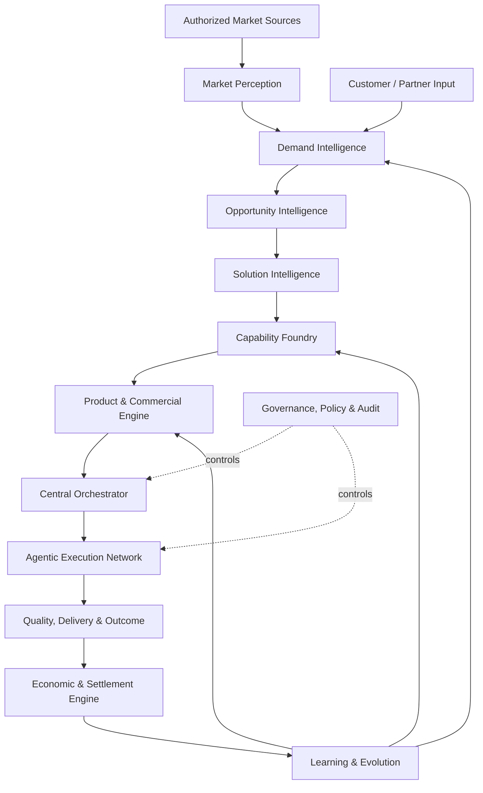

# Master Architecture
Version 1.0 | Baseline

## 1. Architecture at a glance
DAYANEXA is one logical operating system with a central orchestrator and modular domain services. Prefer a modular monolith and durable asynchronous jobs initially; split services only when scale, isolation, or team ownership justifies it.

## 2. Ten domains
1. **Market Perception:** connectors, source registry, polling/webhooks, ingestion policies, source health.
2. **Demand Intelligence:** normalization, entity resolution, clustering, evidence, requester and intent validation.
3. **Opportunity Intelligence:** scoring, prioritization, risk, portfolio and opportunity records.
4. **Solution Intelligence:** problem framing, alternatives, solution design, value hypothesis.
5. **Capability Foundry:** capability registry, gap analysis, build/buy/partner/integrate decisions, readiness tests.
6. **Product & Commercial Engine:** product/service catalog, offer, pricing, quote, contract, customer validation.
7. **Agentic Execution Network:** planner, task decomposition, agent/tool routing, provider and contributor assignment, execution state.
8. **Quality, Delivery & Outcome:** artifact management, quality gates, delivery, acceptance, revision, disputes.
9. **Economic & Settlement Engine:** cost ledger, revenue, invoice, payment verification, contributor settlement, margin.
10. **Learning & Evolution:** outcome analysis, reusable knowledge, capability performance, demand trends, policy feedback.

## 3. Central orchestrator
The orchestrator owns durable workflow state and coordinates domain commands/events. It does not own every domain's business logic. It must provide idempotency, retries, timeouts, cancellation, compensation actions, human-review pauses, correlation IDs, and complete audit trails.

## 4. Two opportunity entry paths
- **Customer-originated:** direct brief, inquiry, referral, partner request, procurement need.
- **Market-originated:** public signals and patterns found through permitted sources. This path starts as a hypothesis, not a confirmed order.

Both paths converge on the same evidence, assessment, solution, capability, commercial, execution, and outcome controls.

## 5. Capability-independent discovery
Discovery services must not filter out demand because no current agent, tool, or contributor can fulfill it. The solution/capability stage decides whether to:
- use existing capability;
- compose existing capabilities;
- build new software, agents, processes, or products;
- acquire/license a tool or provider;
- recruit/contract qualified human contributors;
- form a partnership;
- defer pending feasibility; or
- reject for risk, economics, legality, or insufficient demand.

## 6. Cross-cutting infrastructure
Canonical relational database; object storage for artifacts; queue/event bus; durable workflow engine; connector/adaptor boundary; secrets manager; sandboxed execution; identity and role-based access; observability; audit log; backups; environment separation; data retention controls.

## 7. Data flow rules
- Raw source payloads are immutable, access-controlled, and retention-limited.
- Normalized signals retain source provenance.
- Evidence is distinct from interpretation and confidence.
- A demand hypothesis is not a validated demand.
- An opportunity is not an order.
- An offer is not a contract.
- A delivery is not acceptance.
- An invoice is not payment.
- A payment claim is not verified settlement.

## 8. Deployment boundaries
Development, staging, and production must be isolated. Production credentials never enter client bundles or repository files. Connectors run with least privilege. High-risk execution occurs in isolated environments. Production rollout requires tests, migration review, backup/restore validation, monitoring, and rollback procedure.
