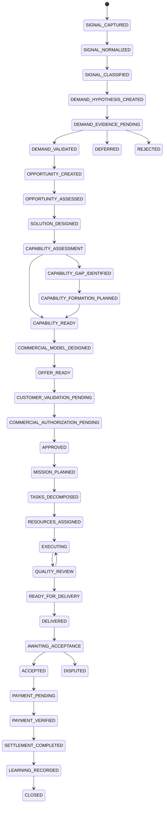

# Opportunity & Mission Lifecycle

## 1. Main lifecycle

## 2. Exception states
`REJECTED`, `DEFERRED`, `CANCELLED`, `FAILED`, `NEEDS_HUMAN_REVIEW`, `SUSPENDED`, `DISPUTED`, `PAYMENT_FAILED`. Every transition records actor, timestamp, reason, policy, and correlation ID.

## 3. State semantics
- Captured/normalized/classified signals are observations, not proof of demand.
- A hypothesis requires evidence collection and validation.
- An opportunity is a value-creation candidate, not a confirmed sale.
- Capability readiness is proven by tests and declared limits.
- Commercial authorization precedes external commitments or paid execution.
- Quality approval precedes delivery.
- Acceptance is explicit and tied to agreed criteria.
- Payment verification uses a trusted payment/bank/provider signal or reconciled record; never infer it from a screenshot alone without review.
- Settlement is recorded only after obligations are actually fulfilled.

## 4. Product venture lifecycle
A reusable product venture may have a separate lifecycle: Problem Pattern → Segment Validation → Solution Prototype → Willingness-to-Pay Test → Capability Formation → Offer Design → Controlled Launch → Retention/Unit Economics → Scale, Pivot, or Sunset. Do not force a multi-customer product through one customer mission record.

## 5. Transition contract
Every transition must define: allowed prior states, actor/agent permission, required evidence, validation predicate, side effects, idempotency key, timeout/retry policy, compensating action, and audit event. Invalid transitions fail closed.
